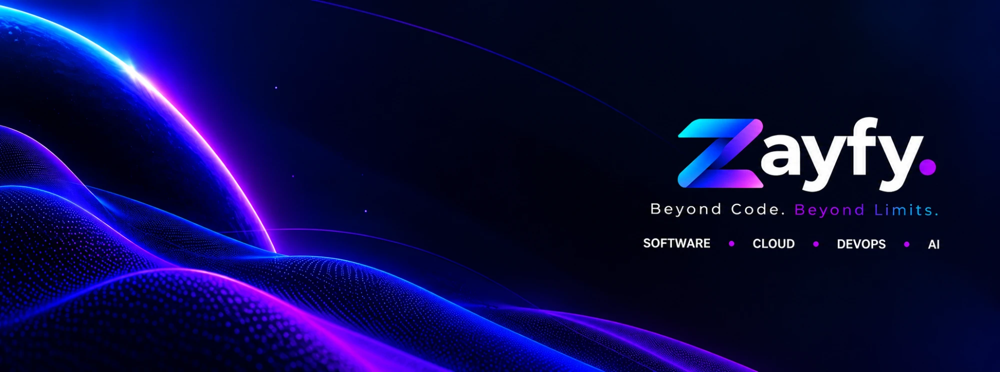

<div align="center">



# ZayfyWeb

**Sitio web oficial de Zayfy.** Software a medida, Cloud, DevOps e inteligencia artificial para empresas que quieren ir más allá.

*Beyond Code. Beyond Limits.*

</div>

---

## Contenido

- [Acerca del proyecto](#acerca-del-proyecto)
- [Stack](#stack)
- [Inicio rápido](#inicio-rápido)
- [Variables de entorno](#variables-de-entorno)
- [Estructura del proyecto](#estructura-del-proyecto)
- [Cómo editar el contenido](#cómo-editar-el-contenido)
- [Sistema de diseño](#sistema-de-diseño)
- [Assets de marca](#assets-de-marca)
- [Estado y hoja de ruta](#estado-y-hoja-de-ruta)
- [Despliegue](#despliegue)
- [Flujo de trabajo](#flujo-de-trabajo)
- [Contacto y propiedad](#contacto-y-propiedad)

## Acerca del proyecto

Zayfy es una empresa tecnológica de Medellín, Colombia, con alcance internacional. Este repositorio contiene su sitio corporativo: una página de aterrizaje (*one-page*) pensada para que un visitante entienda en pocos segundos qué hace Zayfy y cómo contactarla.

**Secciones de la página principal**

| Sección | Ancla | Qué comunica |
|---|---|---|
| Hero | `#inicio` | Presentación de la marca y llamados a la acción |
| Servicios | `#servicios` | Las cuatro líneas de servicio, con panel de detalle |
| Sobre Zayfy | `#nosotros` | Filosofía de la empresa |
| ¿Por qué Zayfy? | n/a | Seis principios diferenciadores |
| Nuestro enfoque | `#enfoque` | Proceso en cuatro etapas: Descubrimos, Diseñamos, Construimos, Evolucionamos |
| Contacto | `#contacto` | Formulario y datos de contacto |

**Servicios**

| Servicio | En una frase |
|---|---|
| **Cloud Rescue** | Recuperamos, estabilizamos y optimizamos infraestructuras Cloud |
| **DevOps Partner** | Un aliado para automatizar, optimizar y evolucionar operaciones tecnológicas |
| **Software Development** | Convertimos ideas en productos digitales funcionales, modernos y escalables |
| **AI & Automation** | Automatización inteligente para hacer más con menos esfuerzo operativo |

Además hay una ruta legal, `/privacidad`, hoy como borrador.

> El sitio no incluye cifras, clientes, testimonios ni certificaciones. Solo se publica información confirmada por Zayfy.

## Stack

| Capa | Tecnología |
|---|---|
| Framework | [Next.js](https://nextjs.org) 16 (App Router) con React 19 |
| Lenguaje | TypeScript |
| Estilos | Tailwind CSS 4, con los tokens de marca definidos en CSS |
| Animación | [Motion](https://motion.dev) (antes Framer Motion) para entradas por scroll; [GSAP](https://gsap.com) con ScrollTrigger para el cierre tipo cortina y los botones magnéticos |
| Iconos | [Lucide](https://lucide.dev) |
| Fuentes | Sora (títulos) e Inter (texto), autoalojadas con `next/font` |
| Calidad | ESLint y TypeScript en modo estricto |
| Procesamiento de imágenes | [sharp](https://sharp.pixelplumbing.com), solo para generar assets de marca |

## Inicio rápido

**Requisitos:** Node.js 20.9 o superior (probado con 20.15) y npm.

```bash
git clone https://github.com/Zayfy/zayfy-web.git
cd zayfy-web
npm install
npm run dev
```

Abre [http://localhost:3000](http://localhost:3000).

| Comando | Qué hace |
|---|---|
| `npm run dev` | Servidor de desarrollo con recarga en caliente |
| `npm run build` | Build de producción |
| `npm run start` | Sirve el build de producción. Como el proyecto usa `output: "standalone"`, Next avisa que lo recomendado es `node .next/standalone/server.js` (es lo que usará Docker en la Etapa 4) |
| `npm run lint` | Revisa el código con ESLint |
| `npx tsc --noEmit` | Revisa los tipos sin generar archivos |
| `node scripts/process-brand-assets.mjs` | Regenera los assets de marca (ver [Assets de marca](#assets-de-marca)) |

## Variables de entorno

Copia la plantilla y ajusta los valores:

```bash
cp .env.example .env.local
```

| Variable | Descripción |
|---|---|
| `NEXT_PUBLIC_WHATSAPP_URL` | Enlace de WhatsApp Business, por ejemplo `https://wa.me/57XXXXXXXXXX`. Si está vacía, el botón no se muestra |
| `NEXT_PUBLIC_LINKEDIN_URL` | Perfil corporativo de LinkedIn. Si está vacía, el enlace no se muestra |

Los archivos `.env*` están ignorados por Git, salvo `.env.example`, que no debe contener valores reales. Nunca subas secretos al repositorio.

## Estructura del proyecto

```text
zayfy-web/
├─ src/
│  ├─ app/                  Rutas, layout raíz, estilos globales e iconos
│  │  ├─ page.tsx           Página principal
│  │  ├─ privacidad/        Aviso de privacidad (borrador)
│  │  └─ globals.css        Tokens de marca y utilidades
│  ├─ components/
│  │  ├─ brand/             Logo
│  │  ├─ effects/           Efectos visuales (partículas)
│  │  ├─ layout/            Header y Footer
│  │  ├─ sections/          Hero, Services, About, WhyZayfy, Process, Contact
│  │  └─ ui/                Button, Reveal, Section y otros componentes base
│  └─ content/es/site.ts    Todos los textos del sitio
├─ public/brand/            Logotipo, símbolo y arte listos para usar
├─ design/brand/            Originales de marca (imágenes fuente)
├─ docs/                    Documentación de arquitectura y diseño
├─ scripts/                 Utilidades (procesamiento de assets)
└─ .env.example             Plantilla de variables de entorno
```

## Cómo editar el contenido

Todos los textos viven en [`src/content/es/site.ts`](src/content/es/site.ts): datos de la empresa, navegación, servicios (con sus capacidades), principios, proceso y mensajes de contacto. Se editan ahí, sin tocar los componentes.

Esa separación deja la estructura lista para añadir inglés más adelante sin reescribir la interfaz.

## Sistema de diseño

La identidad es **oscura, futurista y premium**: fondos profundos, degradados luminosos, vidrio sutil y movimiento contenido.

**Color.** Los valores salen del logotipo original y están definidos como tokens en [`src/app/globals.css`](src/app/globals.css). En los componentes se usan tokens, no colores sueltos.

| Token | Valor | Uso |
|---|---|---|
| `bg-base` | `#050509` | Fondo principal |
| `bg-raised` | `#080d25` | Secciones y tarjetas elevadas |
| `brand-cyan` | `#00d5fd` | Acento, enlaces, foco |
| `brand-azure` | `#0084fd` | Gradiente |
| `brand-blue` | `#1430ff` | Gradiente y botones |
| `brand-violet` | `#861eee` | Gradiente |
| `brand-magenta` | `#f10dfc` | Acento final |

El gradiente de marca va de cian a azul, violeta y magenta. El azul y el violeta no alcanzan contraste suficiente para texto pequeño sobre el fondo oscuro, así que se reservan para gradientes, brillos y rellenos; el texto usa blanco o cian.

**Tipografía.** Sora para títulos e Inter para texto, con escala fluida y mínimo de 16 px en cuerpo.

**Movimiento y accesibilidad**

- Se respeta `prefers-reduced-motion`: sin animaciones ni partículas, con el contenido visible de inmediato.
- Enlace "Saltar al contenido", foco visible y navegación por teclado.
- El panel de detalle de servicios usa `<dialog>` nativo (cierra con Escape y devuelve el foco).
- Las animaciones usan solo `transform` y `opacity`. Las partículas no se activan en móvil y se pausan cuando salen de pantalla.
- La sección de contacto se revela como una cortina solo en pantallas de al menos 1024 × 780 px: queda pegada al borde inferior (`position: sticky`) bajo las secciones anteriores, que forman una capa opaca en `page.tsx`. Ocupa su propio espacio, así que el pie viene después sin taparla. En móvil o pantallas bajas fluye como una sección normal. Si el foco por teclado entra en ella antes de revelarse, la página se desplaza para mostrarla completa.
- El ancla `#contacto` es un marcador sin altura justo antes de la sección. El menú calcula la sección activa con la posición del scroll.
- Los botones magnéticos solo actúan con puntero preciso y sin movimiento reducido. GSAP se importa de forma dinámica.

El razonamiento completo está en [`docs/etapa-1-arquitectura-y-diseno.md`](docs/etapa-1-arquitectura-y-diseno.md).

## Assets de marca

Los originales están en [`design/brand/`](design/brand/). Los archivos de `public/brand/` y los iconos de la app se generan con transparencia a partir de ellos:

```bash
node scripts/process-brand-assets.mjs
```

| Archivo | Uso |
|---|---|
| `public/brand/zayfy-logo.webp` | Logotipo completo (header y footer) |
| `public/brand/zayfy-symbol.webp` | Símbolo con anillo (hero) |
| `public/brand/zayfy-z.webp` | Z aislada (uso decorativo) |
| `public/brand/hero-art.webp` | Planeta y ondas de puntos del hero |
| `src/app/icon.png` | Favicon redondo |
| `src/app/apple-icon.png` | Icono para iOS |

**Reglas de marca**

- No redibujar el logotipo, no cambiar sus colores ni sus proporciones, y dejar espacio libre a su alrededor.
- No sustituir su tipografía.
- No repetir el nombre junto al logotipo.
- La Z aislada solo se usa como isotipo, favicon o elemento decorativo secundario.

> Los originales son imágenes, no vectores. Cuando exista el logotipo en SVG, conviene reemplazar el logotipo y el símbolo para tener nitidez perfecta a cualquier tamaño.

## Estado y hoja de ruta

- [x] **Etapa 1:** arquitectura, sistema de diseño y stack
- [x] **Etapa 2:** frontend responsive con componentes reutilizables y animaciones (primera pasada)
- [ ] **Etapa 3:**
  - [ ] Envío real del formulario (hoy es solo la interfaz), validación y protección contra spam
  - [ ] SEO técnico: metadatos, imagen para redes, `sitemap.xml`, `robots.txt`, datos estructurados
  - [ ] Auditoría de accesibilidad y pruebas
  - [ ] Texto legal definitivo en `/privacidad`
- [ ] **Etapa 4:** Docker, Nginx y GitHub Actions para el VPS
- [ ] Pendientes: versión en inglés, páginas individuales por servicio, analítica y medición de conversiones

## Despliegue

Previsto sobre un VPS de Hostinger con Ubuntu Server 24.04 LTS:

- **Docker** para empaquetar la aplicación (`next.config.ts` ya usa `output: "standalone"`).
- **Nginx** como proxy inverso, con HTTPS mediante certificados TLS.
- **GitHub Actions** para integración y despliegue continuos.
- Dominio: `zay-fy.com`.

Esta parte corresponde a la Etapa 4 y aún no está implementada.

## Flujo de trabajo

1. Crea una rama a partir de `main` para cada cambio.
2. Antes de abrir un *pull request*, verifica que todo pase:

   ```bash
   npm run lint
   npx tsc --noEmit
   npm run build
   ```

3. Describe qué cambia y por qué. Si el cambio es visual, adjunta una captura.

## Contacto y propiedad

- Correo: [connect@zay-fy.com](mailto:connect@zay-fy.com)
- Ubicación: Medellín, Colombia
- Sitio: [zay-fy.com](https://zay-fy.com)

© Zayfy. Todos los derechos reservados. El código, el logotipo y los materiales de marca son propiedad de Zayfy y no están licenciados para uso externo.
